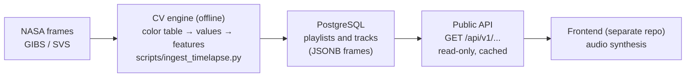

# Earth Jukebox

Earth Jukebox (SpotiEarth) turns NASA Earth-science timelapses into music. Each
visualization (rainfall, sea temperature, air quality, lightning, ocean currents…) is
measured frame by frame, and the measurements drive melody, texture and rhythm, so the
planet's changes can be heard, including by people who cannot see the images.

This repository contains the **backend**: the computer-vision engine that turns images into
data, the offline ingestion tools, and a read-only API that serves playlists and tracks to
the frontend.

> **Frontend and live app.** The frontend lives in its own repository,
> [CrisTristan/earth-jukebox-front](https://github.com/CrisTristan/earth-jukebox-front).
> The deployed application is available at <https://earth-jukebox.space/>.

## How it works



1. **Frames** of a NASA visualization are downloaded into a folder (one image per moment).
2. The **CV engine** (`app/cv_engine`) reads each pixel's color, converts it to a physical
   value using the visualization's color scale, and summarizes every frame into named
   features: how much (`mean`, `coverage`, `p95`), where (`centroid_lat`, `north_share`),
   how many shapes (storms, hotspots) and how much it changed. No neural networks: NumPy and
   OpenCV only.
3. The **ingestion CLIs** store the result as a *track* inside a *playlist* in PostgreSQL.
4. The **API** serves playlists and tracks; the frontend synthesizes the audio on the
   client from each track's per-frame features and sonification hints.

Heavy processing never runs inside the API: ingestion is an offline administrative task.

## Tech stack

| Area | Technology |
|---|---|
| Language | Python 3.13 |
| API | FastAPI, Pydantic v2, pydantic-settings, slowapi (rate limiting), Uvicorn |
| Data | PostgreSQL 18, SQLAlchemy 2.0 ORM, JSONB columns (no migrations: `create_all`) |
| CV engine | NumPy, OpenCV (headless), Pillow |
| Tests | Standard library `unittest` |
| Dev environment | VS Code Dev Container (Docker Compose: `api` + `db`) |

## Repository layout

| Path | Contents |
|---|---|
| `app/main.py` | FastAPI app: CORS, rate limit, health checks, startup checks |
| `app/core/` | Central settings (`config.py`), database engine/session, rate limiter |
| `app/api/v1/` | Versioned public read endpoints |
| `app/services/` | Business logic and database access (playlists, tracks, ingestion) |
| `app/models/` | SQLAlchemy models: `Playlist`, `Track` |
| `app/schemas/` | Pydantic request/response schemas |
| `app/cv_engine/` | Measurement engine, dataset profiles, color tables, regions, globes ([README](app/cv_engine/README.md)) |
| `scripts/` | Offline CLIs: playlist/track ingestion and color-table builders |
| `tests/` | Engine test suite (no database needed) |
| `docs/` | Frame sources and the ingestion plan |
| `.devcontainer/` | Dev Container: Python image and PostgreSQL service |
| `AGENTS.md`, `CLAUDE.md`, `.agents/` | Instructions and skills for AI coding agents |

## Getting started

### Option A: Dev Container (recommended)

1. Install Docker and VS Code with the Dev Containers extension.
2. Copy the environment file: `cp .env.example .env`.
3. Open the folder in VS Code and choose **Reopen in Container**. This starts PostgreSQL
   (`db`) and the Python container (`api`), and installs `requirements.txt`.
4. Inside the container, start the API:

```bash
uvicorn app.main:app --reload --host 0.0.0.0 --port 8000
```

### Option B: Local Python

Requires Python 3.13 and a running PostgreSQL instance.

```bash
python -m venv .venv
source .venv/bin/activate          # Windows: .venv\Scripts\activate
pip install -r requirements.txt
cp .env.example .env               # set DATABASE_URL to your PostgreSQL instance
uvicorn app.main:app --reload --host 0.0.0.0 --port 8000
```

Then open:

- API docs (Swagger): http://localhost:8000/docs
- ReDoc: http://localhost:8000/redoc
- Health: http://localhost:8000/health

Database tables are created automatically at startup.

### Configuration

All settings live in `app/core/config.py` and are read from the environment or `.env`.

| Variable | Required | Default | Purpose |
|---|---|---|---|
| `DATABASE_URL` | **yes** | — | SQLAlchemy DSN, e.g. `postgresql://spotiearth:spotiearth_dev@db:5432/spotiearth` |
| `POSTGRES_USER`, `POSTGRES_PASSWORD`, `POSTGRES_DB` | no | — | Used by the Docker Compose database service |
| `ALLOWED_ORIGINS` | no | `["*"]` | CORS origins as a JSON list; restrict in production |
| `DEFAULT_RATE_LIMIT` | no | `60/minute` | Per-IP rate limit for every endpoint |
| `ENABLE_TEST_ENDPOINTS` | no | `false` | Present in `.env.example`; not used by the code yet |

The API and the ingestion scripts cannot start without `DATABASE_URL`. Never commit `.env`.

## API

All product endpoints are read-only and versioned under `/api/v1`. Every endpoint is rate
limited per IP (`DEFAULT_RATE_LIMIT`).

| Method | Path | Description |
|---|---|---|
| `GET` | `/` | Service name, version and docs link |
| `GET` | `/health` | Database connectivity and engine status (`200` or `503`) |
| `GET` | `/api/v1/playlists` | List playlists. Filters: `?category=`, `?is_featured=` |
| `GET` | `/api/v1/playlists/{slug}` | One playlist with its tracks (without measurements) |
| `GET` | `/api/v1/tracks/{slug}` | One track with everything needed to play it |

```bash
curl http://localhost:8000/api/v1/playlists
curl http://localhost:8000/api/v1/playlists/weather-timelapses
curl http://localhost:8000/api/v1/tracks/geos-temperature-2026-oct-nov
```

### Data model

**Playlist**: `slug`, `title`, `description`, `category`, `cover_url`, `is_featured`,
timestamps, and its ordered `tracks`. Deleting a playlist deletes its tracks.

**Track**: `slug`, `title`, `description`, `sequence_order`, `event_date`, plus three JSONB
fields:

| Field | Contents |
|---|---|
| `source_metadata` | Where the frames come from (profile, frame count, optional public image URL) |
| `engine_metadata` | Dataset information from the engine: unit, value range, thresholds, feature ranges, trends, regions and sonification `hints` |
| `frames` | One entry per frame: features for the whole map, per-region features, top region and an exploration grid |

The playlist detail omits `engine_metadata` and `frames` to stay light; the track detail
includes them. The full engine output contract (schema version 2.2) is documented in
[app/cv_engine/README.md](app/cv_engine/README.md).

## Datasets and the CV engine

Each supported visualization has a **profile** in `app/cv_engine/profiles.py` that tells the
engine how to read it: color table, scale type, units, thresholds, regions and sonification
hints. There are 15 profiles:

| Profile | Dataset | Source | Scale |
|---|---|---|---|
| `imerg-precipitation` | Daily rainfall, 2025 | NASA GIBS (GPM IMERG) | Official color table |
| `sst-anomaly` | Sea surface temperature anomaly, 2003-2026 | NASA GIBS (GHRSST) | Official color table |
| `ndvi-vegetation` | Vegetation index, 2024 | NASA GIBS (MODIS NDVI) | Official color table |
| `geos-temperature` | Near-surface air temperature | NASA SVS 5147 (GEOS-FP) | Rebuilt from color bar |
| `geos-wind` | Near-surface wind speed | NASA SVS 5148 (GEOS-FP) | Rebuilt from color bar |
| `geos-precipitation` | Precipitation and clouds | NASA SVS 5149 (GEOS-FP) | Rebuilt from color bar |
| `geos-humidity` | Near-surface humidity | NASA SVS 5150 (GEOS-FP) | Rebuilt from color bar |
| `geos-pm25` | Fine particulate matter PM2.5 | NASA SVS 5151 (GEOS-CF) | Rebuilt from color bar |
| `geos-o3` | Near-surface ozone | NASA SVS 5152 (GEOS-CF) | Rebuilt from color bar |
| `geos-co` | Carbon monoxide | NASA SVS 5153 (GEOS-CF) | Rebuilt from color bar |
| `geos-nox` | Nitrogen oxides | NASA SVS 5154 (GEOS-CF) | Rebuilt from color bar |
| `ecco2-sst` | Surface currents colored by temperature | NASA SVS 3912 (ECCO2) | Rebuilt from color bar |
| `globe-co2` | Volumetric CO₂ over a rotating globe, 2021 | NASA SVS 5115 | Relative 0-1 index |
| `globe-lightning` | Lightning seen from the ISS, 2017-2023 | NASA SVS 5011 | Relative 0-1 index |
| `globe-ocean-temperature` | Perpetual Ocean 2 tour, temperature | NASA SVS 5425 | Rebuilt from color bar |

- **Official color table**: values come straight from NASA's published XML.
- **Rebuilt from color bar**: the page publishes the color bar only as an image;
  `scripts/colorbar_to_xml.py` reads it. Values are approximate; the script documents which
  scale assumptions are confirmed by the bar ticks.
- **Relative index**: the page publishes no scale; `scripts/haze_ramp_to_xml.py` builds a
  0-1 index from the frames. It is not a physical unit.

The engine handles flat equirectangular maps and planets seen as a sphere (`globe`), including
moving-camera globes where the visible planet is located in each frame. To add a
visualization, add its color table to `app/cv_engine/colormaps/`, define a `DatasetProfile`
and register it in `PROFILES`.

## Ingesting data

Frames are not stored in this repository (`frames/` and `*.png` are git-ignored). The prepared
datasets, one folder per dataset plus a `DATASETS.md` guide (what each dataset shows, its
dates, scale and measured figures), live in the separate **Recursos** repository. The examples
below and `docs/ingest_plan.md` assume a local checkout of it at `data_ingest_resources/`.
`docs/frame_sources.md` links every frame to its NASA original.

Run the CLIs from the repository root. A playlist must exist before its tracks are added:

```bash
# 1. Create a playlist
python scripts/ingest_playlist.py create --slug weather-timelapses \
    --title "Weather Timelapses" --category weather

# 2. Measure a frame folder without touching the database, and review the JSON
python scripts/ingest_timelapse.py --dir data_ingest_resources/air-temperature \
    --profile geos-temperature --slug geos-temperature-2026-oct-nov \
    --title "Near-Surface Temperature, 14-Day Forecast" --playlist-slug weather-timelapses \
    --dry-run --out /tmp/geos-temperature.json

# 3. Ingest it for real (same command without --dry-run/--out)
python scripts/ingest_timelapse.py --dir data_ingest_resources/air-temperature \
    --profile geos-temperature --slug geos-temperature-2026-oct-nov \
    --title "Near-Surface Temperature, 14-Day Forecast" --playlist-slug weather-timelapses
```

`docs/ingest_plan.md` lists the 6 playlists and 15 tracks currently in the database, with
their slugs, titles, descriptions and playback order.

Useful flags of `ingest_timelapse.py`: `--sequence-order`, `--event-date`,
`--frames-url`/`--frames-ext` (public images for the frontend), `--lossy` (frames from video
or JPEG), and `--replace` (re-measure an existing track; destructive). Playlists also support
`list`, `show`, `update` and `delete`. Use `--help` on each script for the full list.

### Scripts

| Script | Purpose |
|---|---|
| `scripts/ingest_playlist.py` | Create, list, show, update and delete playlists |
| `scripts/ingest_timelapse.py` | Measure a frame folder with a profile and store it as a track |
| `scripts/colorbar_to_xml.py` | Build color tables from SVS color bar images |
| `scripts/haze_ramp_to_xml.py` | Build a relative 0-1 index table from frames without a color bar |

## Tests

The suite covers the engine with synthetic images and does not need a database:

```bash
python -m unittest discover -s tests -v
```

## Contributing

- Read [AGENTS.md](AGENTS.md) before changing code: it holds the architecture rules
  (central configuration, service layer, versioned read-only API, no blocking work in the
  event loop) and the ingestion guardrails.
- Code, docstrings, comments and commit messages are in English. User-facing texts shown by
  the app (profile labels and sonification words) are in Spanish.
- Work on a feature branch and open a pull request against `main`. Run the tests first.
- Do not commit `.env`, frames, downloaded imagery or caches.
- AI agents: project skills live in `.agents/skills/` (copies in `.claude/` and `.cursor/`).

## Frontend

The frontend (audio synthesis, player and accessible exploration) is maintained in a
separate repository:
[CrisTristan/earth-jukebox-front](https://github.com/CrisTristan/earth-jukebox-front).

The deployed application is available at <https://earth-jukebox.space/>.

Both sides share the track contract (schema version 2.2). Any change to field names or
shapes is a breaking change: bump the schema version, update this README and the engine
documentation, and coordinate with the frontend repository.

## Data sources and credits

Imagery and data: NASA Global Imagery Browse Services (GIBS) and NASA Scientific
Visualization Studio (SVS), including GEOS-FP and GEOS-CF (NASA GMAO), GPM IMERG, GHRSST,
MODIS, ECCO2 (MIT/JPL), ISS LIS and Perpetual Ocean 2. Each profile's `source` field and
`docs/frame_sources.md` give the exact page. NASA does not endorse this project.

## License

Not defined yet.
