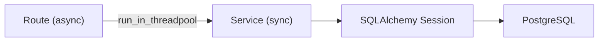

# `app/core/database.py` — database engine and sessions

**Source:** `app/core/database.py`

This module configures the SQLAlchemy connection to PostgreSQL and provides the
shared session dependency used by the API.

## Connection setup

- `_normalize_database_url()` ensures the project uses the declared `psycopg2`
  driver. Generic `postgresql://` and `postgres://` DSNs are rewritten to
  `postgresql+psycopg2://`; DSNs that already name a driver are left unchanged.
- `engine` is created from `settings.DATABASE_URL` with `pool_pre_ping=True`, so
  stale connections are checked before use.
- `SessionLocal` is a session factory configured with `autocommit=False` and
  `autoflush=False`.

## ORM base

`Base` is the declarative base for every model. Importing the models registers
their tables in `Base.metadata`.

## Session dependency

`get_db()` is a FastAPI dependency. It opens a session, yields it to the route,
and always closes it in a `finally` block. Routes receive it through
`Depends(get_db)` and pass it to service functions.

## Schema creation

`init_db()` imports `app.models` to register all tables in `Base.metadata`, then
runs `Base.metadata.create_all(bind=engine)`. The project has no migrations:
tables are created only if they do not already exist, and schema changes must be
handled separately.

## Usage pattern

Database work is synchronous. Routers call service functions through
`run_in_threadpool` so blocking queries do not stop the event loop.

